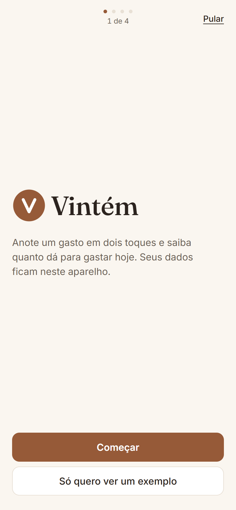
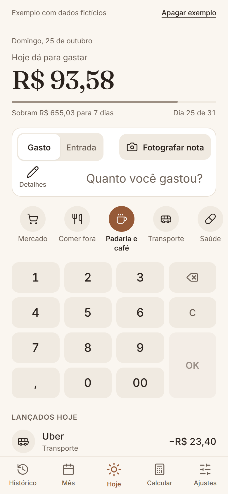
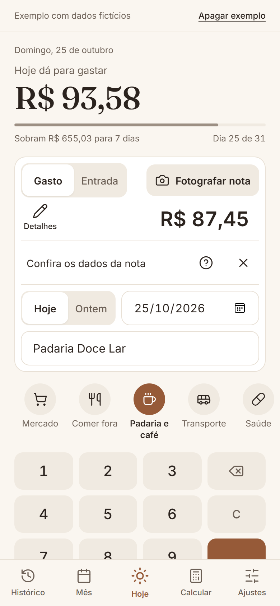
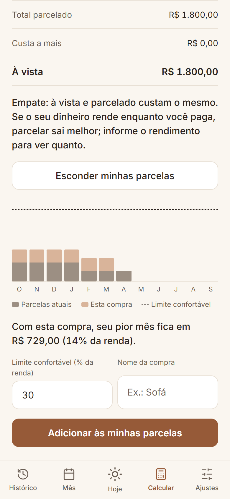
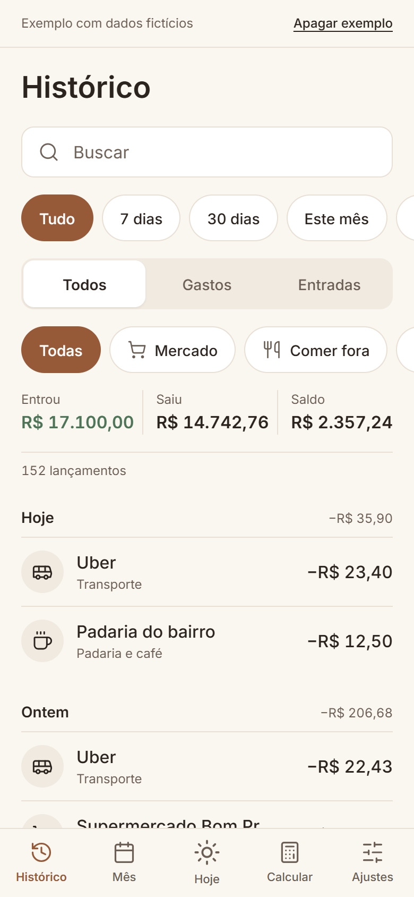
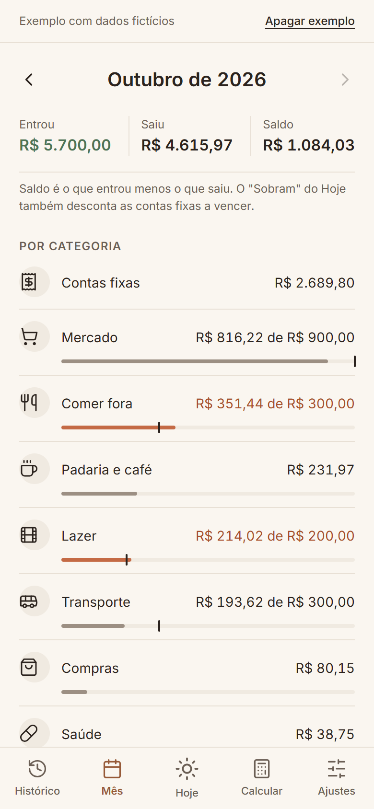
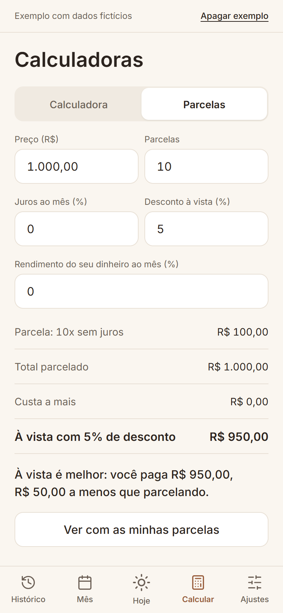
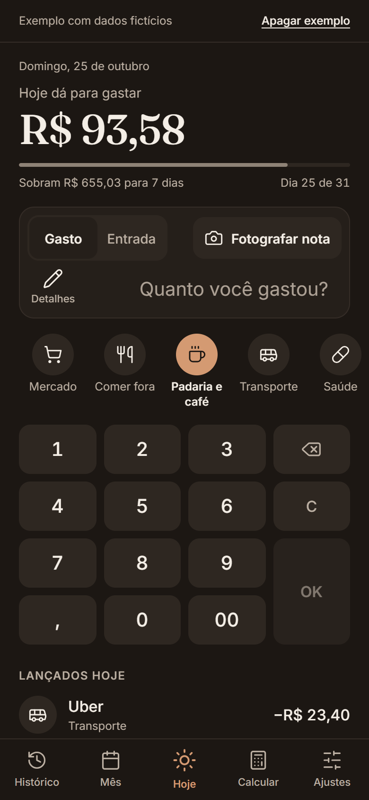
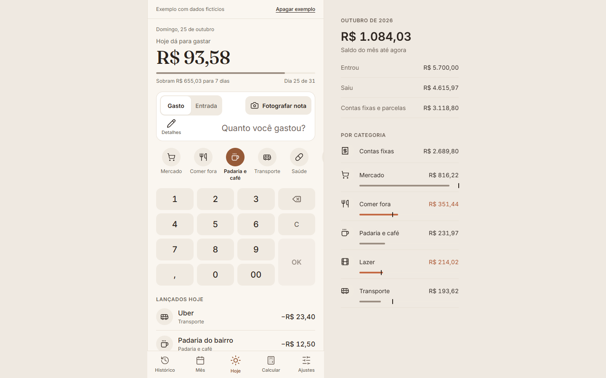

# Vintém

Um app simples de finanças pessoais, feito para o celular. Ele abre já no teclado: você digita quanto gastou (ou fotografa a nota), toca na categoria e pronto. No topo aparece um número só: **quanto dá para gastar hoje** sem passar do mês.

É um arquivo HTML. Não instala nada, não tem login e **os dados ficam só no seu navegador**.

O nome vem do vintém, a moedinha antiga: a ideia é cuidar do dinheiro miúdo do dia a dia. A marca é essa moeda com um V.

| Primeiro acesso | Hoje | Foto da nota | Parcelas |
|---|---|---|---|
|  |  |  |  |

| Histórico | Mês | Calculadoras | Tema escuro |
|---|---|---|---|
|  |  |  |  |

## Primeiro acesso

Na primeira vez, um passo a passo curto pergunta a renda do mês, as contas fixas (com sugestões como aluguel e internet) e as parcelas que você já paga. Dá para **pular** qualquer passo, e tudo pode ser mudado depois nos Ajustes, que também têm **Refazer o primeiro acesso**. Quem só quer conhecer toca em **Só quero ver um exemplo**: abre o app com a Ana, uma pessoa fictícia com 3 meses de lançamentos.

## As 5 telas

- **Histórico:** tudo o que você já lançou, com filtro de data (7 dias, 30 dias, este mês, mês passado, este ano ou datas escolhidas), busca, gasto ou entrada e categoria.
- **Mês:** o que entrou, o que saiu e o saldo; o gasto por categoria (com limite, se quiser); a lista dia a dia.
- **Hoje** (no meio da barra): o número do dia, o visor, as categorias e o teclado.
- **Calcular:** uma calculadora comum e uma de parcelas.
- **Ajustes:** renda, contas fixas, minhas parcelas, categorias, extrato do banco, backup e tema.

## Como se lança um gasto

1. Digite o valor (o visor pergunta "Quanto você gastou?").
2. Toque na categoria.

O aviso **Desfazer** aparece caso tenha errado. Data e descrição ficam em **Detalhes**, que é opcional. Para mudar ou apagar um lançamento, toque nele na lista.

**Fotografar nota:** tire a foto do cupom (no computador, escolha a imagem). O app lê o valor, a loja e a data e deixa tudo preenchido; você confere e toca na categoria. A leitura é automática e pode errar em nota amassada ou escura, por isso nunca lança sozinha. O leitor (Tesseract.js) só é baixado na primeira vez que você usa, a leitura acontece no aparelho e a foto não fica guardada.

## Minhas parcelas

Guarde as compras parceladas que você já paga (nome, valor, quantas faltam). Enquanto não acabam, elas **entram nas contas fixas de cada mês** e já saem do "Hoje dá para gastar".

Na calculadora de parcelas, **Ver com as minhas parcelas** mostra os próximos 12 meses: quanto já está comprometido e quanto a compra nova soma, com uma linha de limite confortável (30% da renda, dá para mudar). Uma frase resume o pior mês. Gostou? **Adicionar às minhas parcelas** transforma a simulação em parcela de verdade (a primeira conta no mês da compra).

## Como sai o "Hoje dá para gastar"

(renda do mês + entradas extras − contas fixas − parcelas do mês − o que você já gastou no mês) ÷ dias que faltam, contando hoje.

Exemplo: renda de R$ 5.400, contas fixas e parcelas de R$ 2.700 e R$ 1.800 já gastos. Sobram R$ 900. Se faltam 10 dias, hoje dá para gastar R$ 90.

- Entrada extra é qualquer entrada fora da categoria Salário (um bico, uma venda): ela faz o número subir.
- Quando pagar uma conta fixa ou parcela, lance em **Contas fixas**: ela não conta duas vezes.
- O "Saldo" da tela Mês é outra conta (o que entrou menos o que saiu) e não desconta o que ainda vai vencer.

## Onde ficam os dados

- No `localStorage` do navegador. Não há servidor: da internet vêm só as fontes do texto.
- Limpar os dados do navegador apaga o app. Use **Ajustes > Exportar backup** de vez em quando.
- Para trazer o extrato do banco: **Ajustes > Importar extrato CSV**. Importar de novo não duplica. Para testar, use `exemplos/extrato-exemplo.csv` (fictício).

## Como rodar e testar

- **Usar:** abra o `index.html` no navegador, no celular ou no computador.
- **Testar:** `pip install websocket-client pillow` e depois `python tests/teste_financas.py`. O teste abre um Edge ou Chrome sem janela e confere o primeiro acesso, os lançamentos, as contas do mês, do histórico, das parcelas e das calculadoras, a leitura de notas, o extrato, o backup, a tela de celular, o contraste e as cores.
- **Publicar no GitHub Pages:** suba a pasta e ligue em **Settings > Pages**.

## Créditos

Os ícones são do [Lucide](https://lucide.dev) (licença ISC), copiados para dentro do `index.html`. As fontes Inter e Fraunces vêm do Google Fonts.
